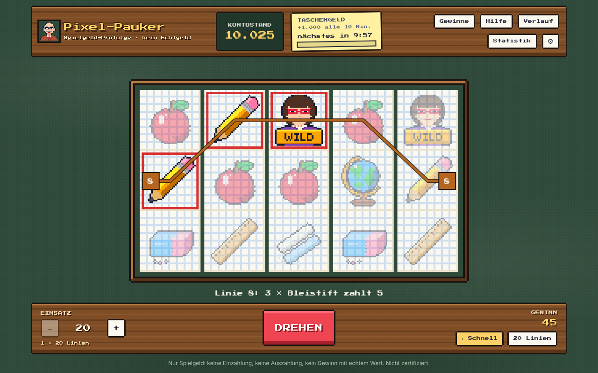
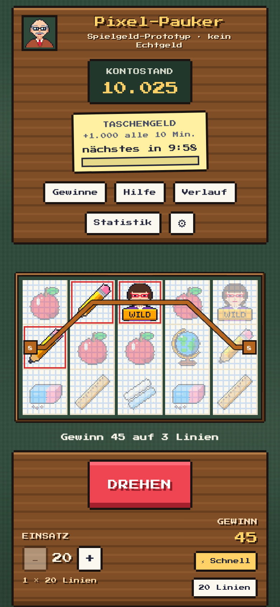

# Pixel-Pauker – Spielgeld-Slot im Schul-Pixel-Look

Ein eigenständiger Video-Slot mit 5 Walzen, 3 Reihen und 20 Gewinnlinien: Lineale,
Bleistifte, Kreide, Schulbücher, der Lehrer und die Direktorin – alles in Pixel-Art,
auf Karopapier vor einer grünen Kreidetafel. Dazu gibt es ein zeitbasiertes
Spielgeld-System („Taschengeld“), eine exakte mathematische Analyse, einen
Monte-Carlo-Simulator und automatische Tests.

> **Nur Spielgeld.** Credits haben keinen Geldwert. Es gibt keine Einzahlung, keine
> Auszahlung, keine Zahlungen und kein Spielerkonto. Das Spiel ist **nicht zertifiziert,
> von keiner Behörde zugelassen und nicht für Echtgeld geeignet** – siehe
> [docs/REGULATORY_READINESS.md](docs/REGULATORY_READINESS.md).

 

## Sofort spielen: `index.html`

Die Datei [`index.html`](index.html) im Hauptverzeichnis ist das **komplette Spiel in
einer einzigen Datei** (ca. 1,6 MB): Programmcode, Grafiken, Pixel-Schrift und der
Simulations-Worker sind eingebettet. Herunterladen und per Doppelklick im Browser
öffnen – es wird kein Server und keine Internetverbindung gebraucht. Die Datei kann
auch auf jeden statischen Webspace (z. B. GitHub Pages) gelegt werden.

Getestet mit Chromium (Desktop und Handy-Ansicht) direkt über `file://`.

## Taschengeld: Spielgeld in festen Zeitabständen

| Regel                   | Wert (in `config/game.config.json` einstellbar)                                     |
| ----------------------- | ----------------------------------------------------------------------------------- |
| Startguthaben           | 10.000 Credits                                                                      |
| Taschengeld             | **+1.000 Credits alle 10 Minuten** (`session.allowance`)                            |
| Erstes Taschengeld      | 10 Minuten nach dem Anlegen des Kontos                                              |
| Ansammeln?              | Nein – nach einer langen Pause gibt es trotzdem nur eine Auszahlung                 |
| Abholen                 | Knopf „+1.000 abholen“ im gelben Zettel oben oder Taste **G**                       |
| Zählt als Gewinn / RTP? | Nein – eigene Buchungsart `grant`, in der Statistik separat als „Taschengeld“       |
| Gespeichert?            | Ja, im Browser (`localStorage`): Kontostand, Einsatz, Taschengeld-Timer, Freispiele |

Ist das Guthaben zu niedrig für den Einsatz, zeigt das Spiel den Countdown bis zum
nächsten Taschengeld (und schlägt einen kleineren Einsatz vor, falls einer reicht).
Wird die Seite mitten in den Freispielen geschlossen, laufen die restlichen Freispiele
nach dem Neuladen weiter – der Einsatz dafür wurde bereits abgebucht. Ein Zurückstellen
der Uhr kann das Konto höchstens ein Intervall lang sperren.

## Symbole und Regeln

| Stufe   | Symbol                                     | 5 / 4 / 3 gleiche (× Linieneinsatz)           |
| ------- | ------------------------------------------ | --------------------------------------------- |
| Niedrig | Lineal, Bleistift, Radiergummi, Kreide     | 50–125 / 15–30 / 5–10                         |
| Hoch    | Schulbuch, Apfel, Globus                   | 200–400 / 50–100 / 15–25                      |
| Premium | Lehrer                                     | 1.000 / 200 / 50                              |
| Wild    | **Direktorin** – ersetzt alle außer Glocke | 2.000 / 250 / 50                              |
| Scatter | **Schulglocke** – zahlt überall            | 100 / 10 / 2 × Gesamteinsatz, 3+ = Freispiele |

- 20 feste Gewinnlinien, Gewinne von links nach rechts; Gesamteinsatz = 20 × Linieneinsatz
  (1, 2, 5, 10, 25 oder 50).
- 3+ Schulglocken: **10 Freispiele („Hitzefrei“)** – alle Gewinne ×2, Gewinne mit
  Direktorin zusätzlich ×2, erneut auslösbar bis 50 Freispiele.
- Maximalgewinn pro Runde: 5.000 × Gesamteinsatz.
- Die vollständige Gewinntabelle steht im Spiel unter „Gewinne“ und in
  [docs/SPECIFICATION.md](docs/SPECIFICATION.md).

Tastatur: Leertaste/Enter = Drehen (nochmal = schnell stoppen), +/− = Einsatz,
T = Schnelldrehen, G = Taschengeld abholen, P/H/S = Gewinntabelle/Hilfe/Statistik,
Esc = Dialog schließen.

## Mathematik (ausgelieferte Konfiguration)

Konfigurations-Hash `4c02cc0a...` – alle Zahlen in [docs/RTP_REPORT.md](docs/RTP_REPORT.md).

| Kennzahl                   | Exakt (vollständige Aufzählung) | Simulation                                                   |
| -------------------------- | ------------------------------- | ------------------------------------------------------------ |
| Auszahlungsquote (RTP)     | **96,0022 %**                   | 96,0370 % (95-%-KI 95,868–96,206 %), 31,1 Mio. Drehs gepoolt |
| Grundspiel / Freispiele    | 70,1744 % / 25,8278 %           | siehe Bericht                                                |
| Trefferquote               | 51,681 %                        | 51,67–51,70 % je Lauf                                        |
| Freispiele ausgelöst       | 1 zu 168,8                      | 1 zu 156–169 je Lauf                                         |
| Standardabweichung/Einsatz | 4,824 (mittel)                  | 4,72–4,83 je Lauf                                            |

Der RTP gilt je Einheit Grundspiel-Einsatz inklusive aller Freispiele. Der exakte Wert
stammt aus der Aufzählung aller 102.400.000 Grundspiel- und 85.656.636
Freispiel-Walzenkombinationen; Simulationen sind unabhängige Bestätigungen. Das
Taschengeld ist kein Spielergebnis und geht in keinen RTP-Wert ein.

## Entwicklung

Voraussetzungen: Node.js 20.19+ (getestet mit Node 22) und npm. Keine API-Schlüssel,
keine kostenpflichtigen Dienste.

```bash
npm ci                     # exakte Abhängigkeiten installieren
npm run dev                # Spiel unter http://localhost:5173 starten
npm run build:standalone   # index.html (Einzeldatei) neu erzeugen
```

| Aufgabe                                                      | Befehl                                                                  |
| ------------------------------------------------------------ | ----------------------------------------------------------------------- |
| Lokales Spiel (mit Entwickler-Diagnose)                      | `npm run dev`                                                           |
| Alle Tests (Typprüfung, Unit/Integration/Mathe, Browser-E2E) | `npm run test:all`                                                      |
| Nur Unit-, Integrations- und Mathe-Tests                     | `npm test`                                                              |
| Nur Browser-Tests                                            | `npm run test:e2e` (beim ersten Mal: `npx playwright install chromium`) |
| Konfiguration prüfen                                         | `npm run validate-config`                                               |
| Exakte Analyse                                               | `npm run analyze`                                                       |
| Simulation (frei wählbar)                                    | `npm run simulate -- --spins 2000000 --seed 7 --workers 4`              |
| Simulations-Presets (100k / 1M / 10M)                        | `npm run simulate:100k`, `simulate:1m`, `simulate:10m`                  |
| Bedingte Simulation seltener Ereignisse                      | `npm run simulate:feature`                                              |
| Mathe-Bericht exportieren                                    | `npm run report`                                                        |
| Normaler Build (`dist/`) + Einzeldatei (`index.html`)        | `npm run build`                                                         |

Simulationsoptionen: `--spins N`, `--seed TEXT` (reproduzierbar) oder `--crypto`
(kryptografischer Zufall), `--workers N`, `--chunk-size N`, `--line-bet N`,
`--out PFAD`, `--config PFAD`. Mit Seed sind die Ergebnisse für jede Worker-Anzahl
identisch.

Nur in der Entwicklungsversion: URL-Parameter `?seed=TEXT` (reproduzierbare Drehs),
`?turbo=1`, `?motion=reduced`, das „Dev“-Panel (u. a. Spielgeld-Konto zurücksetzen).
Die Einzeldatei `index.html` ist ein Produktions-Build: Sie ignoriert `seed` und nutzt
immer den kryptografischen Zufallsgenerator des Browsers.

## Aufbau

```
index.html         fertiges Spiel als Einzeldatei (generiert, nicht von Hand ändern)
web/               Vite-Einstieg (index.html, main.ts, favicon) für dev und build
config/            game.config.json (alle Spielparameter inkl. Taschengeld), reel-design.json
src/config/        Typen, Validierung (Fehler mit Pfad), Kompilierung, SHA-256-Hash
src/rng/           Zufall: Web-Crypto-CSPRNG, Seed-xoshiro128**, Rejection Sampling
src/game/          Engine: Walzen, Linien, Gewinne (Wild/Scatter), Freispiele, Runden,
                   Gewinnobergrenze, Sitzung, Buchungsjournal, Taschengeld, Speicherstand
src/math/          exakte Analyse, Simulation, Statistik, Berichte
src/assets/pixel/  Pixel-Art-Generator (32×32-Raster → SVG) und alle Symbole
src/render/        Phaser-Walzenszene (Holzrahmen, Karopapier, Rotstift), Layout, Brücke
src/app, src/components, src/styles   React-Oberfläche (Deutsch)
scripts/           analyze, simulate, simulate-feature, export-report, validate-config,
                   design-reels, build-standalone
tests/             unit, integration, math, e2e (Playwright, inkl. Einzeldatei über file://)
docs/              Design, Mathematik, Konfiguration, RTP-Bericht, Spezifikation,
                   Sicherheit, Regulatorik, Testergebnisse (auf Englisch)
reports/           erzeugte Analyse- und Simulationsdaten (JSON/CSV)
```

Architektur in Kürze: Die **Konfiguration** wird geprüft und in Zahlentabellen
übersetzt. Die **Engine** macht aus Zufallszahlen Walzenstopps (die einzige Stelle, an
der Zufall eingeht) und wertet das Fenster mit reinen Funktionen aus; Spiel und
Simulator nutzen dieselbe `playNextSpin()`-Funktion. Die **Sitzung** bucht jeden Dreh
(Einsatz, Gewinn, Taschengeld) genau einmal im Journal, **bevor** die Walzen animiert
werden, und speichert danach das Spielgeld-Konto. Das **Mathe-Modul** implementiert die
Regeln unabhängig nach; die Tests verlangen, dass alle Implementierungen übereinstimmen.

## Dokumentation

- [docs/GAME_DESIGN.md](docs/GAME_DESIGN.md) – Konzept, Regeln, Taschengeld, Darstellung, Barrierefreiheit
- [docs/SPECIFICATION.md](docs/SPECIFICATION.md) – Symbole, Gewinntabelle, Linien, Walzenstreifen (generiert)
- [docs/MATHEMATICS.md](docs/MATHEMATICS.md) – Definitionen, Auswertungsregeln, Methoden
- [docs/RTP_REPORT.md](docs/RTP_REPORT.md) – theoretische vs. simulierte Werte (generiert)
- [docs/CONFIGURATION.md](docs/CONFIGURATION.md) – alle Parameter, Validierung, sicheres Ändern
- [docs/SECURITY.md](docs/SECURITY.md) – Zufall, Integrität, gespeichertes Spielgeld, Grenzen
- [docs/REGULATORY_READINESS.md](docs/REGULATORY_READINESS.md) – Weg zu Zertifizierung und Plattform
- [docs/TEST_RESULTS.md](docs/TEST_RESULTS.md) – beobachtete Testergebnisse

## Bekannte Grenzen

- Reiner Browser-Prototyp: Ergebnisse und Spielgeld-Konto entstehen bzw. liegen im
  Browser, den der Spieler kontrolliert. `localStorage` und die Geräteuhr lassen sich
  verändern – für Spielgeld ohne Wert unkritisch, für Echtgeld völlig ungeeignet.
- Der Zufallsgenerator wurde nicht unabhängig geprüft oder zertifiziert.
- Die 5.000×-Obergrenze ist umgesetzt, mit diesen Walzen aber praktisch unerreichbar;
  Wahrscheinlichkeiten unter etwa 1e-13 löst die Analyse nicht auf.
- Konfidenzintervalle der Simulation nutzen die Normalapproximation; bei kurzen Läufen
  und stark schiefen Gewinnen sind sie nur näherungsweise.
- Kein Ton, kein Autoplay bezahlter Drehs; Verlauf und Sitzungsstatistik gelten pro Tab
  und werden nicht gespeichert.
- Die Volatilitätsklasse ist eine dokumentierte Projekt-Konvention, kein Branchenstandard.
- Schnelldrehen, Schnellstopp und Gewinn-Animationen sind in manchen regulierten Märkten
  eingeschränkt.

Glücksspiel kann süchtig machen. Hilfe gibt es z. B. bei der BZgA
(check-dein-spiel.de) oder einer örtlichen Beratungsstelle.

## Lizenz

Eigener Code und eigene Grafiken zu Evaluationszwecken. Für kommerzielles Glücksspiel
wird keine Lizenz erteilt. Die Schrift „Press Start 2P“ (CodeMan38) steht unter der SIL
Open Font License 1.1.
